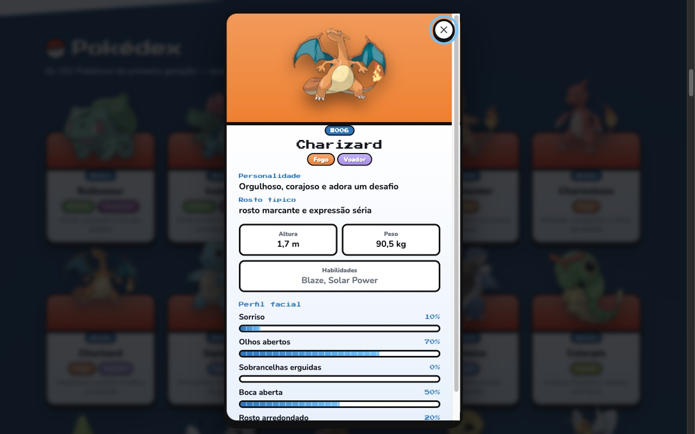
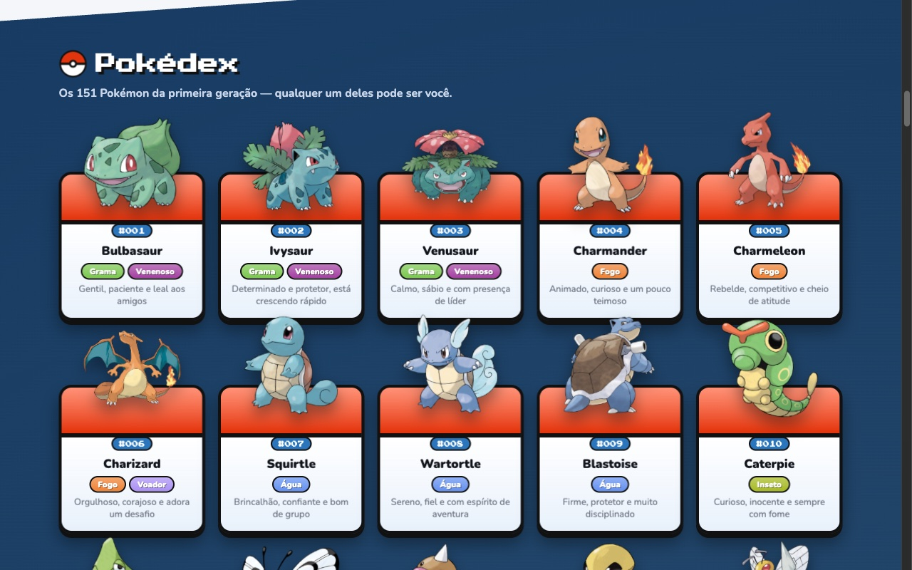
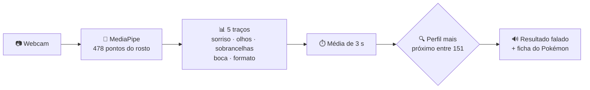

<p align="center">
  
</p>

<h1 align="center">Pokémon Face Scan</h1>

<p align="center">
  <b>Escaneie seu rosto com IA e descubra qual dos 151 Pokémon você seria.</b><br>
  Reconhecimento facial no navegador, com a webcam, sem enviar nenhuma imagem para a internet.
</p>

<p align="center">
  
  
  
  
  
  
</p>

<p align="center">
  <a href="#-como-rodar">Como rodar</a> ·
  <a href="#-como-funciona">Como funciona</a> ·
  <a href="#-galeria">Galeria</a> ·
  <a href="#-estrutura">Estrutura</a>
</p>

<p align="center">
  
</p>

---

## ✨ O que ele faz

| | |
|---|---|
| 🧠 **Reconhecimento facial ao vivo** | O MediaPipe encontra **478 pontos** no seu rosto e desenha a malha em tempo real. |
| 📊 **Leitura dos traços** | Sorriso, olhos, sobrancelhas, boca e formato do rosto, medidos de 0 a 100%. |
| ⚡ **Scan de 3 segundos** | Tira a média dos traços e encontra o Pokémon com o rosto mais parecido com o seu. |
| 🔊 **Resultado falado** | Diz em voz alta (em português) qual Pokémon você é e a personalidade dele. |
| 📕 **Pokédex completa** | Os 151 da 1ª geração com **tipos, personalidade** e ficha com altura, peso e habilidades. |
| 🎨 **Visual de Pokédex** | Degradês, cortes diagonais, efeito 3D e Pokémon gigantes saindo da tela. |
| 🔒 **100% no seu computador** | A câmera é processada no próprio navegador. Nenhuma imagem sai da sua máquina. |

## 🖼️ Galeria

<table>
  <tr>
    <td width="50%"></td>
    <td width="50%"></td>
  </tr>
  <tr>
    <td align="center"><b>Scanner</b>: leitura facial ao vivo e o resultado</td>
    <td align="center"><b>Ficha</b>: tipos, personalidade, altura, peso e perfil facial</td>
  </tr>
</table>

<p align="center">
  <br>
  <b>Pokédex</b>: os 151 Pokémon com tipos e personalidade. Clique num card para abrir a ficha.
</p>

## 🚀 Como rodar

**Requisitos:** Python 3 e um navegador (Chrome, Edge ou Safari) com webcam.

```bash
git clone https://github.com/DougVec/Pokemon-Scanner.git
cd Pokemon-Scanner
python3 server/server.py
```

O navegador abre em **http://localhost:8765**. Clique em **Permitir** quando ele pedir a câmera e depois em **Escanear meu rosto**.

<details>
<summary><b>A câmera não aparece?</b></summary>

- **No navegador:** clique no ícone à esquerda do endereço → *Câmera* → *Permitir* e recarregue a página.
- **No macOS:** Ajustes do Sistema → Privacidade e Segurança → Câmera → ative o navegador e reabra-o.
- Abrir o `index.html` direto (endereço `file://`) não funciona: a câmera só liga em `localhost` ou HTTPS, por isso use o servidor.

</details>

## 🧪 Como funciona



1. **Detecção facial:** o [MediaPipe Face Landmarker](https://ai.google.dev/edge/mediapipe/solutions/vision/face_landmarker) encontra o rosto e os pontos dele.
2. **Medição:** a cada quadro, os pontos viram 5 traços:

   | Traço | Como é medido |
   |---|---|
   | Sorriso | blendshapes `mouthSmileLeft/Right` |
   | Olhos abertos | inverso de `eyeBlinkLeft/Right` |
   | Sobrancelhas erguidas | `browInnerUp` |
   | Boca aberta | `jawOpen` |
   | Rosto arredondado | largura ÷ altura do rosto (pontos 234–454 e 10–152) |

3. **Scan:** ao clicar em *Escanear*, os traços são medidos por 3 segundos e é tirada a média.
4. **Resultado:** cada um dos 151 Pokémon tem um perfil com os mesmos 5 traços. Vence o mais próximo do seu rosto (distância euclidiana).
5. **Ficha:** tipos e personalidade vêm do projeto. Altura, peso e habilidades são buscados ao vivo na [PokeAPI](https://pokeapi.co).

## 📁 Estrutura

```
Pokemon-Scanner/
├── README.md
├── docs/img/            # capturas de tela usadas neste README
├── server/
│   └── server.py        # servidor local (Python, só biblioteca padrão)
├── tests/
│   ├── info.test.mjs    # confere tipos e personalidade dos 151
│   └── pokemon.test.mjs # confere a lista e que todo Pokémon pode ser resultado
└── web/
    ├── index.html       # página
    ├── css/style.css    # visual Pokédex: degradês, cortes diagonais, 3D e animações
    ├── img/pokeball.svg # Pokébola (logo, botões e ícone da aba)
    └── js/
        ├── app.js       # câmera, detecção facial, painel e scan
        ├── dex.js       # Pokédex: cards e ficha de cada Pokémon
        ├── effects.js   # paralaxe e inclinação 3D que seguem o mouse
        ├── info.js      # tipos e personalidade dos 151 Pokémon
        └── pokemon.js   # perfis faciais dos 151 e cálculo do resultado
```

## ✅ Testes

Precisa só do [Node.js](https://nodejs.org), sem instalar nada:

```bash
node tests/pokemon.test.mjs && node tests/info.test.mjs
```

## 🛠️ Personalizar

- **Mudar o perfil de um Pokémon:** edite a linha dele em `POKEMON`, no arquivo `web/js/pokemon.js`. O perfil é `[sorriso, olhos, sobrancelha, boca, redondo]`, cada um de 0 a 1.
- **Mudar tipos ou personalidade:** edite `INFO` em `web/js/info.js`.
- **Duração do scan:** altere `SCAN_MS` em `web/js/app.js`.

## 🙏 Créditos

- Detecção facial: [MediaPipe](https://developers.google.com/mediapipe) (Google)
- Artes e dados dos Pokémon: [PokeAPI](https://pokeapi.co) e [PokeAPI/sprites](https://github.com/PokeAPI/sprites)
- Inspirado no *AI Squat Coach*, que usa MediaPipe para acompanhar exercícios

<sub>Pokémon é marca registrada da Nintendo / Game Freak / The Pokémon Company. Projeto feito apenas para diversão e estudo.</sub>
